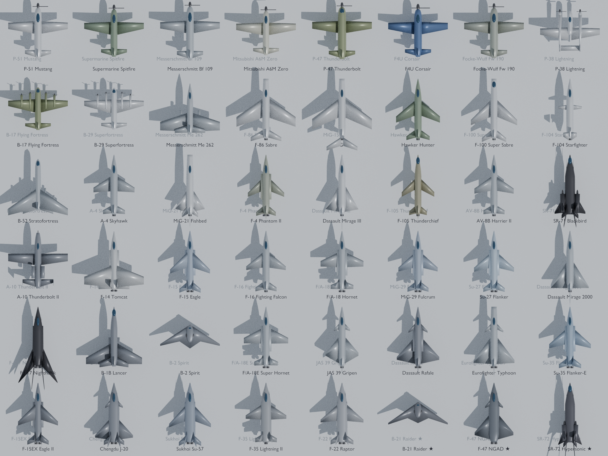

# SkyForge Tycoon

A Roblox military-aviation tycoon. Build an airbase from a WWII **P-51 Mustang**
to the **F-35 Lightning II** and **F-22 Raptor**, then rebirth and do it again faster.



## What's in the game

| | |
|---|---|
| **45 aircraft** across 6 eras | Propeller Age, Jet Dawn, Cold War, Teen Series, Gen 4.5, Stealth Era |
| **17 facilities** | Control tower, radar dome, wind tunnel, Skunk Works... Each gives an income bonus, and one per era is a **gate** you need before the next era opens |
| **3 premium "Black Project" aircraft** | B-21 Raider, F-47 NGAD, SR-72. Sold as game passes, they earn 3x / 5x / 8x your best aircraft |
| **Flyable aircraft** | Every aircraft you own can be flown from your runway (Hangar button) |
| **Rebirths** | Unlocked by buying the F-22. Each one adds a permanent +50% income |
| **Retention** | Vault with a 10-minute cap, daily streak reward, offline earnings, friend bonus, global leaderboard, guide beam to your next purchase |
| **8 plots per server** | The whole map is generated in code, so there's no geometry to build by hand |

### Economy (from `python3 tools/generate.py`)

| Player | First run to the F-22 |
|---|---|
| Free | ~2.4 h (≈3 h with walking and collecting) |
| 2x Cash | ~1.2 h |
| 2x + VIP + Overdrive | ~40 min |
| Free, 1 rebirth | ~1.6 h |

Change the numbers at the top of `tools/generate.py` (`COST_GROWTH`, `PAYBACK_*`, ...) and rerun it.
It regenerates `Items.lua` and prints the new timings.

## Monetization (pay-to-win)

Everything is in `src/shared/Config/Monetization.lua`.

**Game passes:** 2x Cash · VIP Commander (+50%, more offline earnings) · Auto Collect (no vault cap) ·
Overdrive Assembly (+25%) · Afterburner (flight and walk speed) · Starter Pack · 3 Black Project aircraft.

**Developer products:** cash packs that scale with your income (15 min / 1 h / 4 h / 12 h) ·
30-minute 2x boost · Skip Next Purchase · Rebirth Token (+1 rebirth without resetting).

Players are offered purchases at these points: when they touch a pad they can't afford
(at most once every 90 s), on the welcome-back offline-earnings popup, on the Black Project
pads by the entrance, and through the Store button.

Everything is sold at a fixed, clearly described result. There are no paid random rewards
(loot boxes), which Roblox's rules restrict.

Purchases are safe: `ProcessReceipt` records every `PurchaseId` and saves the profile before
it confirms the purchase, so a purchase can't be lost or granted twice. Skip Next with nothing
left to unlock converts to 30 minutes of cash instead of failing.

## Setup

### 1. Get the place into Studio
**Option A, no tools needed:**
```bash
python3 tools/build_place.py
```
Then in Studio use **File → Open from File** and pick `build/SkyForgeTycoon.rbxlx`.

**Option B, Rojo (for live syncing while you edit):**
```bash
rojo serve
```
Then connect from the Rojo plugin in Studio.

### 2. Turn on data saving
Home → Game Settings → Security → **Enable Studio Access to API Services**. Without it the
game still runs, but progress isn't saved.

### 3. Set up the game passes and products
On the Creator Dashboard, create each pass and product listed in `Monetization.lua`
(suggested Robux prices are in the file). Paste each ID into its `id = 0` field.
Anything left at `0` shows "SOON" in the store and can't be bought.

### 4. (Optional) Swap in the Blender meshes
The game runs right away with aircraft built from Parts. To use the Blender meshes instead:
1. Studio → **Avatar → Import 3D** (or the 3D Importer), then import `models/<id>/<id>.fbx`.
2. Rename the imported Model to the aircraft id (`f22`, `p51`, ...).
3. Put it in a folder **`ReplicatedStorage/AircraftMeshes`**.

`AircraftBuilder` will use it automatically, with auto-scaling. The mesh named `Body` is
recoloured per aircraft.

## Regenerating the Blender models
```bash
python3.11 -m pip install bpy
python3.11 blender/generate_aircraft.py --sheet docs/aircraft_sheet.png
```
You can also run it from Blender itself: `blender -b -P blender/generate_aircraft.py`.
Each aircraft is built from parameters in `tools/aircraft_data.py`: dimensions, sweep, taper,
tail type, engines, canards, and special shapes (flying wing, twin boom, Blackbird...).
Every model comes out as `.fbx`, `.obj` and an editable `.blend`, at 700–1,200 triangles.

**Adding an aircraft:** add one line to `AIRCRAFT` in `tools/aircraft_data.py`, then run
`tools/generate.py` and the Blender script. It gets a bay, a price, an income and a model,
and it's flyable.

## Project layout
```
tools/aircraft_data.py      single source of truth: aircraft + facilities
tools/generate.py           -> src/shared/Config/{Aircraft,Items}.lua, data/aircraft.json, economy sim
tools/build_place.py        -> build/SkyForgeTycoon.rbxlx (Rojo-compatible, no Rojo needed)
tools/check_syntax.py       approximate Luau syntax check (pip install lupa)
blender/generate_aircraft.py procedural models -> models/<id>/
src/shared/                 configs, Layout, AircraftBuilder, Format
src/server/                 Data, Tycoon, Monetization, Flight, Leaderboard, WorldBuilder
src/client/                 UI, Flight controls, Effects
```

## Flight controls
Mouse to aim · **W/S** throttle · **A/D** roll · **Shift** afterburner · **F** or **Space** to exit.
On mobile, the plane follows the camera.

## Before launch
- Playtest with 2+ players (Studio → Test → Clients and Servers) to check plot assignment and saving.
- Tune flight feel in `Config/Game.lua` (`FlightSpeedScale`, `FlightStudsPerMetre`).
- Add audio IDs in `Effects.Sounds` (`src/client/Controllers/Effects.lua`).
- Note: real aircraft names are used. Their manufacturers' logos and trademarks are not.
